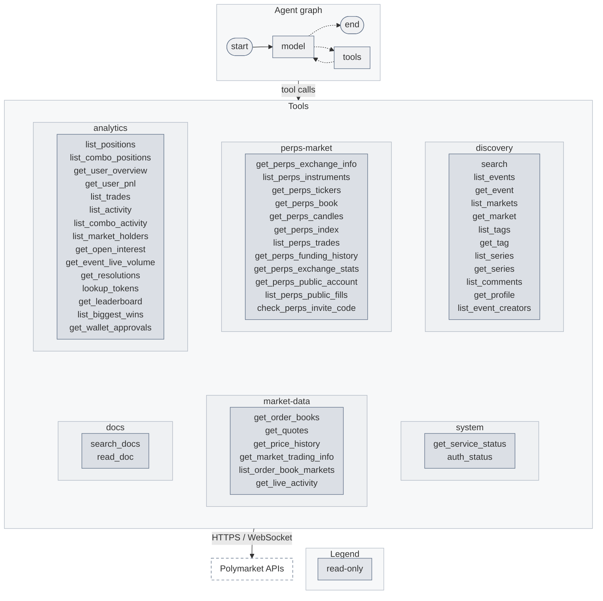

<!-- mcp-name: io.github.tukorama/mcp-server-polymarket -->

# MCP server and LangGraph tools for Polymarket

[](https://pypi.org/project/mcp-server-polymarket/)
[](https://github.com/tukorama/mcp-server-polymarket/actions/workflows/ci.yml)
[](https://github.com/tukorama/mcp-server-polymarket/blob/main/LICENSE)

`mcp-server-polymarket` is a Model Context Protocol (MCP) server for the
[Polymarket](https://polymarket.com) APIs, covering both **Predictions** (Gamma, CLOB, Data API,
Relayer, Bridge, Combos and the WebSocket feeds) and **Perps** (perpetual futures, HTTP and
WebSocket). The same tools are packaged for LangGraph and LangChain. Reading needs no account.
Trading and transfers exist too, switched off until you turn them on.

> [!WARNING]
> Unofficial, and not affiliated with Polymarket. Orders and transfers move real money and cannot
> be undone, and an agent can misread a market. Polymarket restricts trading in some countries and
> regions; check that you are allowed to trade where you are. Start with `dry_run` and small
> limits. This software comes with no warranty (see the license).

## Why this exists

Pointing an agent at the Polymarket APIs goes wrong in a few predictable ways, and each one
shaped this package.

- **There are seven APIs and two hundred endpoints.** The tools are curated: one tool answers one
  question (`get_quotes` reads best bid, ask, midpoint, spread, tick size and minimum size for any
  number of tokens in one request) and toolsets keep rarely needed areas out of the context.
- **Responses are huge.** A single event can be 28 KB and a search result 80 KB. Tools return
  trimmed, typed results with outcomes, prices and token ids paired up, and lists are paged.
- **Signing is easy to get subtly wrong.** Orders, Deposit Wallet batches and Perps operations are
  signed locally, checked against the official SDK's test vectors, and never with a guessed wallet
  type.
- **An agent should not be able to spend money by accident.** Writes are hidden until you enable
  them, checked against per-order and daily USD limits and a price-sanity band, and confirmed by
  the user with a description the server writes, not the model. Withdrawals go only to your own
  wallet or an allowlist.
- **Networks fail after sending.** A write whose outcome is unknown is journaled, an identical
  new request is blocked, and `resend_write` resends the exact signed bytes, which Polymarket
  deduplicates. Nothing that moves money is ever retried automatically.

## Quick start

Reading markets, books, prices, positions and Perps data needs nothing but the server.

### Claude Code

```bash
claude mcp add polymarket -- uvx mcp-server-polymarket
```

### Claude Desktop, Cursor, VS Code and others

```json
{
  "mcpServers": {
    "polymarket": { "command": "uvx", "args": ["mcp-server-polymarket"] }
  }
}
```

Now ask for something like "What does Polymarket give for a Fed cut in December, and how deep is
the book?" or "Show me BTC perp funding over the last week."

## Trading

Trading needs the `signing` extra, your wallet's address and a signing key.

1. **Install with signing.** Use `uvx --from "mcp-server-polymarket[signing]" mcp-server-polymarket`
   wherever the examples say `uvx mcp-server-polymarket`.
2. **Configure the key and wallet.** Put the private key in a file readable only by you and set
   `POLYMARKET_PRIVATE_KEY_FILE` to its path, and `POLYMARKET_WALLET_ADDRESS` to your Polymarket
   wallet (the address shown on polymarket.com, not the key's own address). The server works out
   the wallet type from the two and refuses a mismatch.
3. **Create CLOB credentials once**, in a terminal:

   ```bash
   uvx --from "mcp-server-polymarket[signing]" mcp-server-polymarket auth
   ```

   They are saved to `~/.config/mcp-server-polymarket/session.json`, readable only by you. The
   private key is never written to disk by this package.
4. **Turn trading on** in the server's environment: `POLYMARKET_ALLOW_TRADING=true`. Optionally
   lower `POLYMARKET_MAX_ORDER_USD` (100 by default) and `POLYMARKET_MAX_DAILY_USD` (1000).
5. **Check** with `mcp-server-polymarket status`, which lists what is configured and every hidden
   tool with the step that would show it.

```json
{
  "mcpServers": {
    "polymarket": {
      "command": "uvx",
      "args": ["--from", "mcp-server-polymarket[signing]", "mcp-server-polymarket"],
      "env": {
        "POLYMARKET_PRIVATE_KEY_FILE": "/Users/me/.config/polymarket/key",
        "POLYMARKET_WALLET_ADDRESS": "0x...",
        "POLYMARKET_ALLOW_TRADING": "true",
        "POLYMARKET_MAX_ORDER_USD": "20"
      }
    }
  }
}
```

Your MCP client must support **elicitation** (asking the user a question mid-call), because every
order is confirmed there. A client without it gets a refusal, not a silent order.

**Use a session key for day-to-day trading.** On a Deposit Wallet, the owner key can do anything,
including withdrawing. A session key can trade but cannot move funds out. Authorise one with the
owner key, then run the server with the session key instead:

```bash
mcp-server-polymarket auth --session-key 0xSESSION_KEY_ADDRESS
```

and set `POLYMARKET_PRIVATE_KEY_FILE` to the session key and `POLYMARKET_SIGNER_ROLE=session_key`.
The `wallet` and transfer tools need the owner key and stay hidden.

**On-chain actions** (`setup_trading_approvals`, `split_position`, `merge_positions`,
`redeem_positions`, `deposit_to_perps`) go through Polymarket's gasless Relayer and need a Relayer
API key from your Polymarket account: `POLYMARKET_RELAYER_API_KEY` and
`POLYMARKET_RELAYER_API_KEY_ADDRESS`.

**Perps** need a separate session, created once:

```bash
mcp-server-polymarket auth --perps            # a trading key that cannot withdraw
mcp-server-polymarket auth --perps --read-only
```

**Moving funds** (Perps deposits and withdrawals, bridge withdrawals) needs
`POLYMARKET_ALLOW_TRANSFERS=true` as well, is capped by `POLYMARKET_MAX_TRANSFER_USD`, and is
always confirmed, whatever `POLYMARKET_CONFIRM` says.

**A safe first run:** preview an order with `dry_run`, place a post-only order at the minimum size
far from the market and cancel it, and on Perps set the leverage you already have.

`mcp-server-polymarket logout` forgets stored credentials; `logout --revoke` also deletes the CLOB
API key on Polymarket, `logout --builder-key` revokes the builder key, and `logout --perps`
revokes and forgets the Perps session.

## LangGraph and LangChain

The `langgraph` extra gives you plain LangChain tools in the same process, with no MCP server to
run. It also has a prebuilt agent.

```bash
uv add "mcp-server-polymarket[langgraph,signing]"
```

```python
from mcp_server_polymarket.integrations.langgraph import (
    create_polymarket_agent,
    get_polymarket_tools,
)

agent = create_polymarket_agent("anthropic:claude-sonnet-5-5")
config = {"configurable": {"thread_id": "1"}}
result = await agent.ainvoke({"messages": [("user", "How likely is a Fed cut?")]}, config=config)

# Or take the tools and build your own graph:
tools = get_polymarket_tools(toolsets="auto,+sports", prefix="pm_")
```

The tools work from sync and async graphs. When trading is enabled, every order or transfer pauses
the graph with `interrupt()`, carrying the same confirmation text the MCP server would show.
Resume with `Command(resume=True)` to go ahead; any other value declines. Interrupts need a
checkpointer, which the prebuilt agent creates in memory (pass your own, or `checkpointer=None` on
LangGraph Platform). `get_polymarket_tools()` leaves those tools out unless you pass
`include_gated=True`, because they only work inside a graph with a checkpointer. See
[examples/langgraph_agent.py](https://github.com/tukorama/mcp-server-polymarket/blob/main/examples/langgraph_agent.py)
and the LangGraph Platform app in
[examples/langgraph_app](https://github.com/tukorama/mcp-server-polymarket/tree/main/examples/langgraph_app).

To keep Polymarket in a separate process, connect over MCP instead. This route needs
`langchain[mcp]`, which LangChain still marks as beta.

```python
from langchain.agents import create_agent
from langchain.mcp import MCPAdapter

config = {"mcpServers": {"polymarket": {"command": "uvx", "args": ["mcp-server-polymarket"]}}}
async with MCPAdapter(config) as adapter:
    agent = create_agent("anthropic:claude-sonnet-5-5", await adapter.list_tools())
```

`draw_mermaid(agent)` draws a graph with its Polymarket tools grouped by toolset and colored by
what they can change. The prebuilt agent without credentials:



## Tools

There are 128 tools in 18 toolsets. Without credentials the default set exposes 49. Tools that need
credentials or a gate appear only when they are configured; `auth_status` and
`mcp-server-polymarket tools` explain the rest.

Choose toolsets with `POLYMARKET_TOOLSETS`: `auto` (the default), `all`, `predictions`, `perps`, a
list of names, or adjustments such as `auto,+sports,-docs`.

**Always available with `auto`**

| Toolset | Tools |
|---|---|
| `discovery` | `search`, `list_events`, `get_event`, `list_markets`, `get_market`, `list_tags`, `get_tag`, `list_series`, `get_series`, `list_comments`, `get_profile`, `list_event_creators` |
| `market-data` | `get_order_books`, `get_quotes`, `get_price_history`, `get_market_trading_info`, `list_order_book_markets`, `get_live_activity` |
| `analytics` | `list_positions`, `list_combo_positions`, `get_user_overview`, `get_user_pnl`, `list_trades`, `list_activity`, `list_combo_activity`, `list_market_holders`, `get_open_interest`, `get_event_live_volume`, `get_resolutions`, `lookup_tokens`, `get_leaderboard`, `list_biggest_wins`, `get_wallet_approvals` |
| `perps-market` | `get_perps_exchange_info`, `list_perps_instruments`, `get_perps_tickers`, `get_perps_book`, `get_perps_candles`, `get_perps_index`, `list_perps_trades`, `get_perps_funding_history`, `get_perps_exchange_stats`, `get_perps_public_account`, `list_perps_public_fills`, `check_perps_invite_code` |
| `system` | `get_service_status`, `auth_status` |
| `docs` | `search_docs`, `read_doc` (docs.polymarket.com only) |

**With credentials (`auto`)**

| Toolset | Needs | Tools |
|---|---|---|
| `account` | CLOB credentials | `get_my_account_status`, `list_my_open_orders`, `get_my_order`, `list_my_trades`, `get_my_balance_allowance`, `list_my_notifications`, `get_my_wallet_status`, `get_relayer_transaction`, `list_relayer_transactions`, `watch_my_orders` |
| `perps-account` | Perps session | `get_my_perps_account`, `get_my_perps_portfolio`, `list_my_perps_orders`, `list_my_perps_fills`, `get_my_perps_history`, `list_my_perps_funding`, `list_my_perps_transfers`, `get_my_perps_rewards`, `list_my_perps_notifications`, `watch_my_perps` |
| `trading` | signer + `ALLOW_TRADING` | `place_limit_order`, `place_market_order`, `place_orders`, `resend_write`, `mark_notifications_read`; with `ALLOW_CANCEL` alone: `cancel_orders`, `cancel_all_orders`, `list_unconfirmed_writes` |
| `wallet` | owner key + Relayer key + `ALLOW_TRADING` | `setup_trading_approvals`, `split_position`, `merge_positions`, `redeem_positions` |
| `perps-trading` | Perps session + `ALLOW_TRADING` | `place_perps_orders`, `modify_perps_orders`\*, `set_perps_leverage`, `adjust_perps_margin`, `apply_perps_referral_code`, `create_perps_invite_code`, `mark_perps_notifications_read`; with `ALLOW_CANCEL`: `cancel_perps_orders`, `cancel_all_perps_orders`, `set_perps_auto_cancel`; with `ALLOW_TRANSFERS`: `deposit_to_perps`, `withdraw_from_perps`, `transfer_perps_internal`\* |

**On request (`+name`)**

| Toolset | Tools |
|---|---|
| `sports` | `get_sports_metadata`, `list_teams`, `list_sports_results`, `watch_sports` |
| `rewards` | `list_reward_markets`, `get_maker_rebates`, `get_my_reward_earnings`, `list_my_reward_markets`, `get_my_order_scoring` |
| `streams` | `watch_market`, `watch_live_data`, `watch_perps_market` |
| `bridge` | `list_bridge_assets`, `get_bridge_quote`, `get_bridge_status`, `create_deposit_addresses`, `create_withdrawal_addresses` (transfers) |
| `combos` | `list_combo_markets`, `get_combo_request`, `plan_collateral_return`, `trade_combo`\*, `execute_collateral_return`\* (trading) |
| `builder` | `get_builder_leaderboard`, `list_builder_trades`, `list_builder_api_keys`, `list_relayer_api_keys`, `get_my_perps_builder`, `set_perps_builder_approval` (trading) |
| `perps-extras` | `get_perps_leaderboard`, `list_perps_competitions`, `get_perps_competition`, `get_perps_position_snapshots`, `get_my_perps_blp`, `set_perps_blp_enrollment` (trading) |

\* Experimental: the wire format comes from the documentation and has not been verified against
the live API.

`watch_*` tools open a WebSocket, collect events for a few seconds or up to a count, and return a
summary; they do not stream indefinitely.

Resources: `polymarket://perps/instruments`, `polymarket://markets/{slug}`, and reference pages
under `polymarket://docs/` (`concepts`, `trading`, `perps`, `safety`).

Prompts: `research_market`, `review_portfolio` and `plan_perps_trade`. None of them trades.

### API coverage

Every operation in the published OpenAPI and AsyncAPI specifications listed in
[docs.polymarket.com/llms.txt](https://docs.polymarket.com/llms.txt), plus the routes the guides
describe, is either called by a tool, used by the CLI (key creation and revocation), or listed
with a reason in
[coverage.py](https://github.com/tukorama/mcp-server-polymarket/blob/main/src/mcp_server_polymarket/coverage.py).
A test checks this against a manifest generated from the specifications, and that the test suite
calls every endpoint. Deliberately left out: CLOB heartbeats (they need a five-second loop),
Combos market making (a 400 ms quote loop), and Perps `PATCH /v1/account/builder`, whose signed
payload is undocumented. The separate Polymarket US exchange is not covered.

## Configuration

All settings are environment variables with the `POLYMARKET_` prefix. A `.env` file in the
working directory also works, except for the gates, limits, confirmation mode, allowlist, builder
settings, service URLs, file paths and the bearer token, which have to be set in the real
environment so that a file in a project directory cannot turn trading on.

| Variable | Default | Purpose |
|---|---|---|
| `PRIVATE_KEY_FILE`, `PRIVATE_KEY` | | Signing key (owner or session key). Prefer the file |
| `WALLET_ADDRESS` | | Your Polymarket wallet. Needed for anything signed |
| `SIGNER_ROLE` | `owner` | `session_key` when the key is a Deposit Wallet session key |
| `SIGNATURE_TYPE` | detected | 0 EOA, 1 Proxy, 2 Safe, 3 Deposit Wallet; only checked against detection |
| `API_KEY`, `API_SECRET`, `API_PASSPHRASE`, `ADDRESS` | | Existing CLOB credentials, for account reads without a private key |
| `RELAYER_API_KEY`, `RELAYER_API_KEY_ADDRESS` | | Relayer key for wallet transactions |
| `PERPS_PROXY`, `PERPS_SECRET`, `PERPS_PROXY_KEY` | | An existing Perps session instead of `auth --perps` |
| `TOOLSETS` | `auto` | See [Tools](#tools) |
| `ALLOW_CANCEL` | `false` | Cancel tools only |
| `ALLOW_TRADING` | `false` | Orders, leverage, wallet transactions (includes cancel) |
| `ALLOW_TRANSFERS` | `false` | Deposits, withdrawals and transfers |
| `CONFIRM` | `elicit` | `none` skips the confirmation question for trading, never for transfers |
| `MAX_ORDER_USD` | `100` | Per order. `0` blocks, `unlimited` lifts |
| `MAX_DAILY_USD` | `1000` | Per UTC day, separately for orders, Perps orders and transfers |
| `MAX_PERPS_ORDER_USD` | `500` | Per Perps order (reduce-only orders are exempt) |
| `MAX_PERPS_LEVERAGE` | `5` | Highest leverage `set_perps_leverage` accepts |
| `MAX_TRANSFER_USD` | `100` | Per transfer |
| `MAX_PRICE_DEVIATION` | `0.10` | Refuse prices this far through the book or mark |
| `TRANSFER_ALLOWLIST` | | Comma-separated recipients other than your own wallet |
| `BUILDER_API_KEY`, `BUILDER_SECRET`, `BUILDER_PASSPHRASE`, `BUILDER_CODE`, `PERPS_BUILDER` | | Builder program attribution |
| `SESSION_FILE`, `PERPS_SESSION_FILE`, `JOURNAL_FILE` | `~/.config/mcp-server-polymarket/…` | Stored credentials and the write journal |
| `CACHE_DIR` | `~/.cache/mcp-server-polymarket` | Instrument, label and docs cache |
| `HTTP_TIMEOUT` | `20` | Seconds per HTTP request |
| `HTTP_BEARER_TOKEN` | | Required by the HTTP transport on a non-local address |
| `LOG_LEVEL` | `INFO` | Logs go to stderr |
| `GAMMA_URL`, `CLOB_URL`, `DATA_URL`, `PERPS_URL`, … | Polymarket's | Service endpoints, `https` and `wss` only |

On Windows the two directories are `%APPDATA%\mcp-server-polymarket` and
`%LOCALAPPDATA%\mcp-server-polymarket`, and files are protected by your user profile rather than
POSIX permissions.

To serve over HTTP:

```bash
POLYMARKET_HTTP_BEARER_TOKEN=change-me mcp-server-polymarket serve --transport streamable-http --host 0.0.0.0
```

The server refuses a non-local address without a token. `/health` stays open for probes. Do not
expose a server with trading enabled to anyone you would not hand your wallet.

## How it behaves

**Confirmation.** Each order, wallet transaction and transfer is described by the server from
market data (outcome name, price, shares, cost, wallet, recipient) and confirmed by the user before
it is signed. Declining returns `declined`; nothing is sent. Cancels are not confirmed.

**Checks before signing.** Tick size (off-tick prices are refused, never rounded), minimum size,
distance from the best price or mark, per-order and daily limits, leverage cap, Protocol V1/V2
exchange version, and Polymarket's geoblock check, which fails closed. Missing balance or
allowance is reported, never fixed by an automatic approval.

**Unknown outcomes.** If the connection drops after a write is sent, the tool returns
`unknown` with a `request_id`. An identical request is blocked until you check
(`list_unconfirmed_writes`) and either resend the same bytes (`resend_write`) or let it expire
after 15 minutes. The journal keeps signed bodies only for those writes.

**Retries.** Reads retry with backoff and honour `Retry-After`. Orders, cancels and transfers are
never retried automatically.

**Long calls.** Claude Desktop has been reported to cancel stdio tool calls after about a minute,
so for that client waits (Relayer confirmations, `watch_*`) are capped at 45 seconds. A Relayer
transaction still unconfirmed then returns `pending` with an id for `get_relayer_transaction`.

**What is never logged.** Private keys, API secrets, passphrases, HMAC signatures and signed
bodies are masked in logs and errors by exact value. Market descriptions and comments are
stripped of control and bidirectional characters, and the agent guide marks them as untrusted.

## Limitations

- Read tools have been run against the live APIs. Order placement, cancels, wallet transactions,
  Perps operations and transfers have been tested against recorded responses, the official SDK's
  signing test vectors and a differential test against the SDK, but **not with real funds**. The
  tools marked experimental are less proven still. Make your first live writes small.
- Polymarket changes its APIs often. `live.yml` runs the live read tests, the manifest check and
  the SDK comparison weekly. Protocol V2 markets start on 2026-11-23; the V2 exchange contracts
  and position ids are supported but could not be tried before launch.
- Wallet transactions support Deposit Wallets only. Proxy and Safe wallets can trade on the CLOB
  but cannot use the `wallet` toolset, because their Relayer signing is not documented. An EOA
  (signature type 0) cannot use the gasless Relayer at all.
- Session keys cannot trade Combos.
- `session.json` and `perps_session.json` are plaintext protected by file permissions. Keep the
  private key in a file of its own, or in your own secret store passed through the environment.
- Check that your use of automated trading complies with Polymarket's terms and the law where you
  are.

## Development

To point a client at a checkout, use
`uvx --from "/path/to/mcp-server-polymarket[signing]" mcp-server-polymarket`, or
`uv add --editable ../mcp-server-polymarket` from your LangGraph project. See
[CONTRIBUTING.md](https://github.com/tukorama/mcp-server-polymarket/blob/main/CONTRIBUTING.md)
and [RELEASING.md](https://github.com/tukorama/mcp-server-polymarket/blob/main/RELEASING.md).

The protocol details follow Polymarket's documentation and the MIT-licensed
[polymarket-client](https://pypi.org/project/polymarket-client/) SDK, which is used as a test
oracle; see
[NOTICE](https://github.com/tukorama/mcp-server-polymarket/blob/main/NOTICE).

## License

[MIT](https://github.com/tukorama/mcp-server-polymarket/blob/main/LICENSE)
